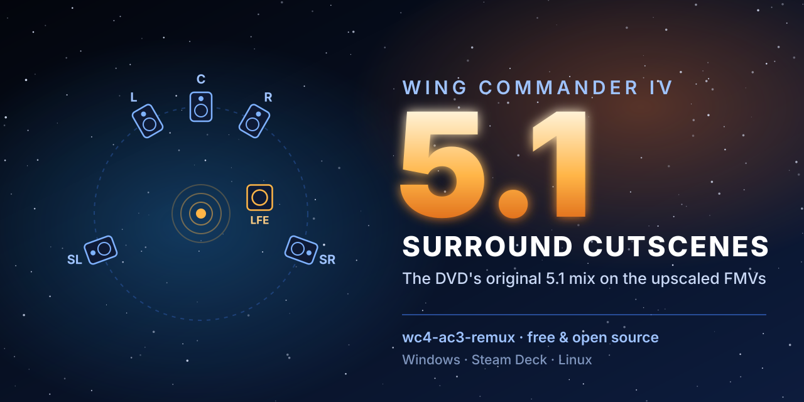

# wc4-ac3-remux



Audio fixes for **Wing Commander IV: The Price of Freedom** (30th Anniversary Edition):

1. **Dolby Digital 5.1 cutscenes** (Windows and Linux): the DVD version's 5.1 mix on the FMVs, level-matched.
2. **In-game audio on Linux / Steam Deck** (Proton only): a fix for Wine's DirectSound on 5.1/7.1 output. See
   [In-game audio on Proton](#in-game-audio-on-proton-linux--steam-deck).

## 5.1 cutscenes

The anniversary release (Steam/GOG) has three FMV sets, one per Steam launch option, and all of them play **stereo** audio:

| Steam launch option | Folder | 5.1 after this tool |
|---|---|---|
| WC4 Enhanced - Master FMVs Upscaled | `WC4_Enhanced/Master_FMVs_Upscaled` (1080p) | 238 of 278 clips (tested) |
| WC4 Enhanced - Master FMVs Source | `WC4_Enhanced/Master_FMVs_Source` (1080p, less processed) | 238 of 278 clips (same timing as Upscaled; **not verified on real files**) |
| WC4 Enhanced - DVD FMVs | `WC4_Enhanced/vob` (640x480, stereo copies of the DVD video) | 244 of 278 clips (tested) |

The fourth launch option, **WC4 DVD Edition**, runs the original 1996 DVD build from `WC4_DVD/`. Its `.vob` files
already carry the 5.1 mix; they're where this tool takes the audio from, so leave `WC4_DVD` installed.

The original DVD-ROM version, which is bundled in the same release (`WC4_DVD/vob`), has a real discrete **5.1** mix: dialogue in the center, independent surrounds, LFE. This tool puts that 5.1 track onto the FMV sets you choose, without touching the video.

It works on **your own installed files**. No game content is downloaded or distributed.

## Download

Grab the zip for your OS from [Releases](../../releases) and extract it anywhere. It includes ffmpeg, so there's nothing else to install, and the tool never downloads anything.

| OS | File | Status |
|---|---|---|
| Linux / Steam Deck / SteamOS (x64) | `wc4-ac3-remux-linux-x64.zip` | Tested (SteamOS 3.9) |
| Windows (x64) | `wc4-ac3-remux-windows-x64.zip` | **Untested, but should work.** Reports welcome. |

### Windows security warnings

`wc4-ac3-remux.exe` isn't code-signed, so Windows SmartScreen will likely show **"Windows protected your PC"** the first time. Click **More info → Run anyway**. Microsoft Defender doesn't flag the 1.0.0 build (VirusTotal: 1 of 71 engines, a machine-learning score from Trapmine). To check what you're running:

- Compare the zip's SHA-256 with `SHA256SUMS` in the release (PowerShell: `Get-FileHash .\wc4-ac3-remux-windows-x64.zip`).
- Or build it yourself from this source (`./build.sh`, Go 1.23+).

## Use

**Windows:** double-click `wc4-ac3-remux.exe`.
**Linux / Deck:** in a terminal in the extracted folder, `./wc4-ac3-remux`

Keep `ffmpeg` and `ffprobe` in the same folder as the tool. If they're missing, it uses an ffmpeg installed on your system instead.

With no options, it walks you through the setup:

1. **Install:** found automatically from your Steam libraries, or paste the path (you can also drop the `Wing Commander IV` folder onto the program).
2. **FMV sets:** all installed sets (default), or just one.
3. **Keep the originals?** Clips are always replaced in place, so the normal launch options play them.
   - *Yes:* each original is moved (renamed, not copied) into `<folder>.orig` just before it's replaced. Run the tool
     again and it offers **Restore**. Needs up to the set's size in extra disk space (about 5 GB for the 1080p sets).
   - *No:* restore with Steam's **Verify integrity of game files** if you ever want the originals back.
4. **Loudness** (see below): +6 dB recommended.
5. **In-game audio fix** (Linux only, shown when a WC III/IV Proton prefix is found): install, keep, update or remove
   the patched `dsound.dll`. See [In-game audio on Proton](#in-game-audio-on-proton-linux--steam-deck).

It takes a few minutes. Set your audio output to 5.1 or 7.1 to hear the surround.

### Options (skip the questions)

```
--sets <list>      upscaled,source,dvd (default: all installed)
--gain <dB>        loudness boost for the 5.1 track (default 6; 0 = exact DVD audio, no re-encode)
--keep-originals   move each original clip into <folder>.orig before replacing it
--restore          move the kept originals back (undo)
--force            rebuild clips that are already done
--no-pause         don't wait for Enter at the end

Linux only (each does just that, no cutscene work):
--proton-audio          install the in-game audio fix into the WC III/IV Proton prefixes
--remove-proton-audio   remove it and restore Proton's own dsound.dll
```

Example: `wc4-ac3-remux --sets upscaled --gain 6 "D:\SteamLibrary\steamapps\common\Wing Commander IV"`

Re-running is safe. Finished clips are skipped, and a different `--gain` rebuilds them.

## In-game audio on Proton (Linux / Steam Deck)

On a **5.1 or 7.1** output (an AV receiver over HDMI, for example), Wine's DirectSound gets WC IV's in-game audio
wrong, and WC III's too:

- **Any sound with a volume set loses every speaker but the front pair.** Wine only computes gains for the first
  two channels, so centre, LFE and surrounds get 0. On WC IV's loadout screen the game turns speech and UI sounds
  down 5 dB, and Wine drops four of six speakers on top: everything suddenly sounds much quieter.
- **Mono sounds at full volume go to every speaker at full gain, LFE included.** So the same sound jumps between six
  speakers and two depending on whether the game set a volume.
- **Mono on 7.1 is broken**: channels carry stale memory. WC III plays sound effects from the left speaker only, or
  as a loud buzz.

On Linux the tool offers to install a patched `dsound.dll` into the WC III/IV Proton prefixes (wizard step, or
`--proton-audio` / `--remove-proton-audio`). With it, the games' sounds play from the front pair at consistent levels,
like on stereo output, while the 5.1 cutscenes (played by libvlc, not DirectSound) keep all six channels.

- It replaces `compatdata/<appid>/pfx/drive_c/windows/syswow64/dsound.dll` (Proton's symlink is saved in
  `dsound.dll.orig-link`) and adds `"dsound"="native"` to the prefix's `user.reg` DLL overrides (one-time backup
  `user.reg.bak-wc4-ac3-remux`). Close the game first.
- **A Proton version change restores Proton's own `dsound.dll`**: run the tool again afterwards.
- **WC IV only:** its 1996 mix has speech 5 dB under the music, so for WC IV's executables the DLL halves the volume
  cuts the game asks for (speech/SFX come up about 2.5 dB). For the original mix, add
  `WINE_DSOUND_VOLUME_SCALE=1 %command%` to WC IV's launch options (0 to 1; 0 ignores the game's volumes). WC III
  gets its original mix.
- Not needed on stereo output, and not needed on Windows (the Windows build doesn't include it).

The DLL is Proton 11's `dsound` (Valve `proton_11.0` @ `e60892c`) with
[`proton/dsound-proton_11.0-e60892c.patch`](proton/dsound-proton_11.0-e60892c.patch); rebuild it with
[`proton/build.sh`](proton/build.sh). Tested on SteamOS 3.9 with proton-cachyos 11.0 and a 5.1 HDMI output: the
game's stream carries audio on front left/right only, the other channels are exact zeros, and the loadout screen no
longer drops in level. The 7.1 path follows the same code but hasn't been listened to. The underlying bugs are also
in upstream Wine; [`proton/upstream/`](proton/upstream/) has the patch series (compile-tested on Wine master) and
drafts for the Wine merge request and a Proton issue.

### Simpler alternative: stereo while playing

If stereo is enough (your receiver can upmix it with Dolby Surround, DTS Neural:X and so on), switching the output
to stereo while the game runs avoids all of these bugs without touching the prefix.
[`extras/stereo-while-playing.sh`](extras/stereo-while-playing.sh) does that automatically: it switches the current
HDMI output to its stereo profile, runs the game, and switches back. Make it executable and add
`/path/to/stereo-while-playing.sh %command%` to the game's launch options. Tested on SteamOS with PipeWire and an
HDMI receiver.

## How it works

- **Video:** copied bit-for-bit from the set's MP4. No re-encode.
- **Audio:** the DVD's AC-3 5.1 track. With the default gain it's raised and re-encoded at 640 kbps AC-3 (source is 384 kbps). With `--gain 0` it's stream-copied.
- **Sync:** each clip's offset was measured by cross-correlating the set's stereo track against a downmix of the DVD 5.1. For the 1080p masters most clips are +22 ms and a few differ (the intro is +122 ms), with no drift within a clip (checked across the 9-minute intro). The result lands within about 1 ms of the original masters. The 640x480 set was transcoded from the DVD, so its offset is 0 for every clip.
- **Track tagging:** the Enhancement Patch picks the FMV audio track by the game's language, so the new track keeps the original track's language tag.
- **Languages:** offsets and skip lists were measured on the **English** release, where the DVD carries English 5.1 only. Steam also has German and French versions (separate downloads), presumably with dubbed DVD audio. The tool should work on them, but that's **untested**. It prints a note when the audio isn't English, and reports are welcome.

### Loudness

The stereo masters were heavily loudness-processed (around −5 LUFS). The DVD mix keeps its dynamic range (−19 to −23 LUFS), which is about 15 dB quieter, so the FMVs sound quiet next to the rest of the game. By default the tool adds **+6 dB**, with a −1 dB peak limiter that only acts on the loudest moments (explosions and the like); in testing that sat best against the in-game audio. The same gain goes on every clip, so the balance between scenes is unchanged. Choose +10, +15 (as loud as the masters, but heavily limited) or 0 (untouched DVD audio) if you prefer.

**Clips that keep stereo are level-matched too.** The 1080p masters were normalised clip by clip to about −8 LUFS, so without this the stereo-only clips would play 4–14 dB louder than the 5.1 clips around them. Each one is re-levelled (AAC re-encode, video untouched) to the DVD mix's loudness plus the same gain, **capped at −23 LUFS + gain** (−17 LUFS at +6), the level of a typical 5.1 dialogue scene. Most stereo-only clips are short in-flight events (e.g. SC_8011A) that were mixed hot even on the 1996 DVD and are heavily limited in the masters, so they have almost no dynamics and sound much louder than their LUFS number suggests. A peak limiter (−2 dB) also tames the masters' clipped peaks. Clips whose DVD audio is silent have no reference and are left alone (they're already quiet).

## Clips that keep their own audio

| Clips | Sets | Why |
|---|---|---|
| SC_2470C, SC_2900D, SC_2900E, SC_5150A–G | all | The DVD's audio track for these is **silent**. SC_2470C is a Rollins dialogue branch that plays mute on the 1996 DVD (and in the 640x480 set). The 2900 and 5150 clips are exterior and corridor shots whose sound only exists in the 1080p masters. |
| 24 clips (SC_1200A–D, 2120A–C, 3300A–B, 7330A–7380A, most of the 8000 series) | all | The DVD only has **2.0** AC-3 for these, with no Dolby Surround flag. Nothing to gain. |
| SC_2570A | 1080p masters | The master is a 0.04 s stub (an upstream issue; the DVD and the 640x480 set have a 15.6 s flyby). |
| SC_3460C, SC_2170C, SC_3630A, SC_8000A, SC_8001A | 1080p masters | Different edits between DVD and master (lengths differ), so a straight audio swap would desync. The 640x480 set matches the DVD, so these get 5.1 there. |

The tool also checks every clip at runtime (DVD clip present, matching length, 5.1 source, a valid 6-channel output). Anything that fails a check keeps its stereo audio.

## Requirements

- Wing Commander IV 30th Anniversary Edition with `WC4_DVD` still installed (it's part of the release; if you deleted it, Steam's *Verify integrity* brings it back)
- The `wc4w_en` Enhancement Patch build that ships with it (the `Master_FMVs_Upscaled` launch option)

## Undo

- *If you kept the originals:* run the tool again and choose **Restore** (or `--restore`).
- *Otherwise:* Steam → right-click the game → Properties → Installed Files → **Verify integrity of game files**.

A game update may also restore the stereo files; rerun the tool afterwards. The in-game audio fix (Linux) is removed
with `--remove-proton-audio`.

## Credits

- **Matt Wells** for the [Wing Commander IV Enhancement Patch](https://github.com/mattwells77) that the anniversary edition is built on, and its configurable FMV path.
- The anniversary edition team for the upscaled masters.
- [FFmpeg](https://ffmpeg.org), and eugeneware/ffmpeg-static for the static builds.

### Bundled ffmpeg

The release zips include `ffmpeg` and `ffprobe` unmodified from [eugeneware/ffmpeg-static](https://github.com/eugeneware/ffmpeg-static/releases/tag/b6.1.1) release `b6.1.1`: Windows is ffmpeg 6.1.1 (gyan.dev build), Linux is ffmpeg 7.0.2 (johnvansickle.com build). They're GPL v3. Their license and build/source details ship in each zip as `FFMPEG-LICENSE.txt` and `FFMPEG-README.txt`, and the FFmpeg source is at [ffmpeg.org](https://ffmpeg.org/download.html). This tool only runs them as separate programs and is MIT licensed.

Wing Commander is a trademark of Electronic Arts. This project is not affiliated with EA or Origin Systems.

## Building

```
./build.sh        # needs Go 1.23+; outputs dist/
./package.py      # release zips with bundled ffmpeg (Python 3)
```

## License

MIT
